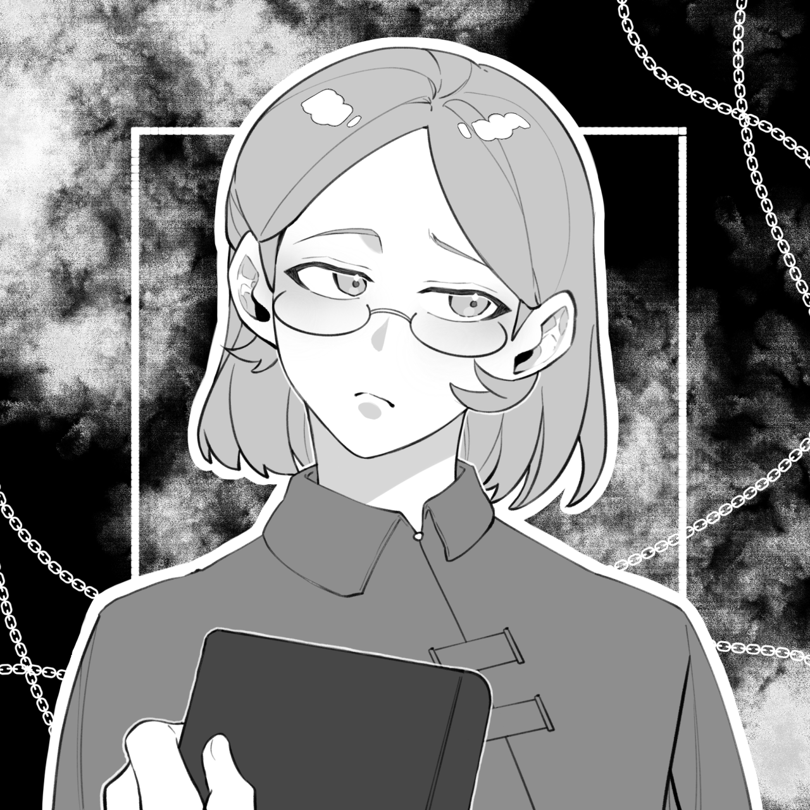

# 泽娜·欧恩斯坦

**泽娜·欧恩斯坦（Zena Ornstein）**，议会第六席，帝国大图书馆管理员。

维克提出、安德烈跟进的龙血实验的唯一幸存者。孤儿出身，被图书馆收留，无学术产出，某种意义上是藏品之一。外表年轻实际四十好几。

人生简单到只有三段经历——孤儿、实验体、图书馆管理员。唯一称得上血脉相连的是给予她龙血的安德烈，而她在血宴中亲手斩断了这段关系。

## 龙人化

龙血实验赋予了她龙人化的超然力量，但她并不引以为傲——这只让她愈发感觉自己是人群中的异类。

龙人化是泽娜独有的能力。实验的本意是批量创造稳定可控的强大战士，效果并不好：大部分失败的实验体因过度的变化不可逆而直接死亡。龙人化本质是压榨生命换力量：她的变化可控，但反复催化肉体的代谢会减少寿命，所以她不会滥用。

常态下她是纯粹的人类，本身是一个不错的魔法师，但不是经过贵族特化教育的战场法师，对战斗力的帮助并不高，在量级参照表上只有 1。龙人化时，龙的信息显化并盖过人类部分，身体组织短时间内被破坏，然后迅速再生、重构，攀升到 6——这是不怎么依赖技巧的纯数值。

## 德鲁伊之道

血宴后离开德拉科尼斯，开始流浪。最终来到格莱德尼亚森林，找到退休中正在陪老师的艾登，走上德鲁伊之道。

德鲁伊追求万物共谐。化形是法术，而发自内心地平等看待万物——人、兽、鸟、虫都只是自然生灵的不同形态——是德鲁伊自身的风格与自肃。对泽娜而言，便是将龙也一视同仁，将体内的暴戾视为自己的一部分，改变认知，以唯心的力量实现更平衡、稳定的龙化控制。龙人化本就可控，问题在于反复催化对寿命的消耗，这个问题在她后续的旅途中得到了解决。

这份和解也包括承担自己犯下的错——她杀死了安德烈、掀起了内乱的序幕，也应当努力为其画下休止符。

## 关系

萨菲恩缇娅的朋友。戴斯蒙德·格兰蒂斯从她口中得知了艾德琳分裂帝国的计划。
