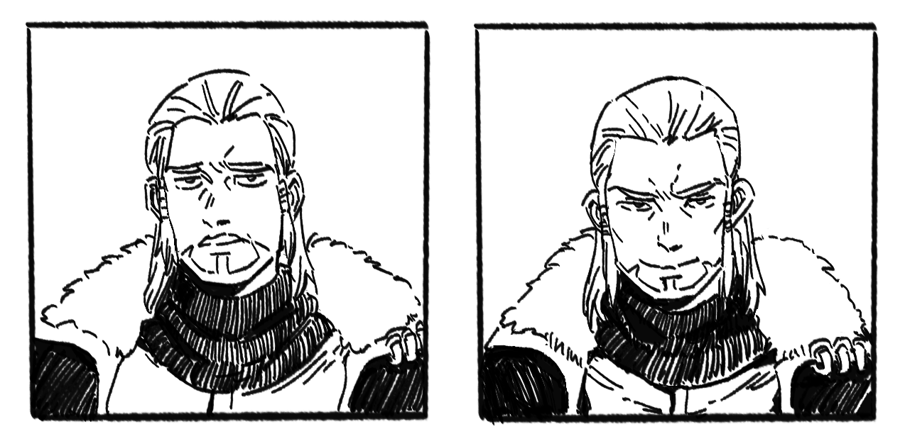

# 洛德·欧恩斯坦

**洛德·欧恩斯坦（Lord Ornstein）**，议会第四席，白色守望副军团长兼参谋军官。

安德烈提拔的军派龙裔——安德烈作为总帅是帝国军事事务的最高领袖，洛德是他一手培养的继任方向。

## 北境

按照传统，龙裔会被派遣到边境驻守历练。安德烈将洛德派往北境，用意是让他在历练的同时多和北地人交往——北境非七冠盟誓成员，是帝国二次扩张才并入的领地，人种有差异，与中央疏远。安德烈希望洛德去监督并拉拢他们。

但洛德被奥列克算计了。格莱德尼亚遗民和北方蛮族（北境之外）在奥列克撮合下围攻北境多处据点，洛德连续战事失利被当地人驱逐，帝国戍边军团几乎遣散。奥列克乘机上演救场逆转，顺势成为北境实际控制者。原本的北境驻军被奥列克重新整编成了白色守望，他把洛德找回来，继续让他担任军团领袖——洛德有用但不能有权。洛德由此留任白色守望副军团长，议会第四席的身份悬空。

第二次内战中被定义为叛党核心。

副官是蕾菲尔：北地女战士，实力值得信赖，和洛德关系亲近（会直接扯他领子）。

## 赫尔曼·奥利维亚

与赫尔曼·奥利维亚是挚友。少年时洛德怂恿赫尔曼去偷飞龙的蛋，赫尔曼真的付诸实践了；赫尔曼深入龙脊山脉的悬崖巢区摸到了蛋，洛德在山外接应。

## 实力

拥有一个高级贵族应有的所有训练和教育，但不擅理术。受过训练的龙裔在数值版 20+ 到 25 的区间，洛德就在这个区间；在量级参照表上为 5。与伊尔莎能力近似：伊尔莎更具天赋，洛德技艺更好，整体大概伊尔莎更强。洛德本身不是什么热衷战斗的选手，他的实力在 5 档里也不算突出，是有依靠血统垫到 5 的。
