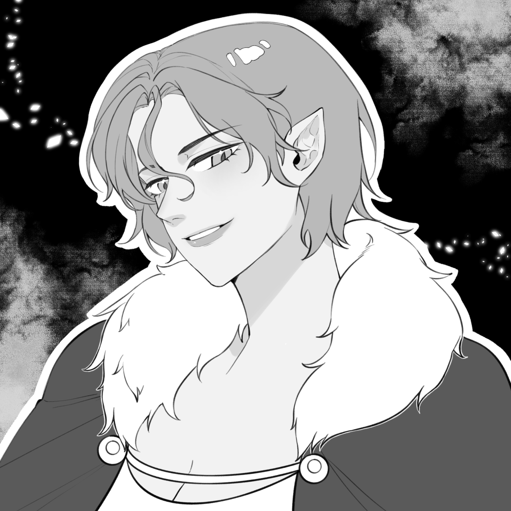

# 艾德琳·欧恩斯坦

**艾德琳·欧恩斯坦（Edeline Ornstein）**，议会第三席，外交官。

龙裔×精灵混血【旧设定】，血统劣于同辈，头发是罕见的绿色。智商极高，比起暴力更依赖谋划，也因此成为皇帝天然的合伙人。大姐头般的人物，虽然真心喜爱着弟弟妹妹们，但将弱肉强食作为信条贯彻，思维可能比其他龙裔更接近龙。龙裔多受欲望驱动，她渴望的是权力。

驻格莱德尼亚的外交官，负责帝国与精灵间的事宜。血宴的总导演。

## 待核

- 龙裔×精灵混血：旧档已标【旧设定】。新档中精灵是某位不朽者与人类的后代，龙裔则全部出自温德林与梅特卢姆家族女性的血脉；艾德琳的出身是保留混血、改写，还是另定？
