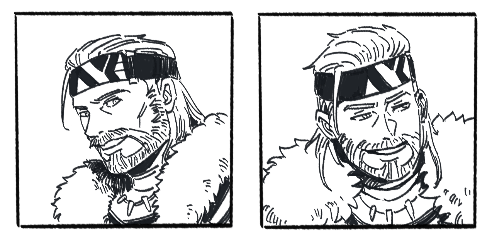

# 艾登·奥布莱恩

**艾登·奥布莱恩（Aidan O'Brian）**，诺德兰小有名气的典范级（Paragon）冒险者，德鲁伊。瑞秋的养父。名字 Aidan 意为火，O'Brian 意为布莱恩之子。

  

北境人（蛮族出身），出身奥布莱恩氏族——蛮族社会中的贵族氏族，其氏族禁制见 力量与规则／禁制（Geis）。蛮族出身，对很多社会礼节不太在意。

## 德鲁伊

当世极少数拥有完整德鲁伊传承的人类，同期学习者仅四人，他是唯一成为见习德鲁伊的。

装备：橡木杖（老师亲手制作的触媒，完成传承修行时的赠礼，刻有代表平静与治愈的符文）、牙龙皮革背包、银色金属片护额、绿色防风披肩。

德鲁伊能力：具备变形为动物的能力；入夜以冥想恢复魔力时，会与附近的动物和植物产生联系，共享感知，以维持与自然的纽带——远离自然的德鲁伊将逐渐失去力量。

在量级参照表上为 5（典范）。

## 老师

老师是一位不朽者（世俗称作真·精灵），女性。七冠时代她对德鲁伊信仰产生浓厚兴趣，前往格莱德尼亚认真学习并保存了绝大部分传承；帝国的屠杀过后，她是最后一名大德鲁伊，如今帝国境内仅存的橡木的贤者。艾登只是德鲁伊。

她与巫妖安德里亚斯的友人"贤者"不是同一位。

艾登当年因暗恋老师才去修行，直到毕业单相思。

## 退休

年事已高（鬓角已白），计划带瑞秋南下交接人脉后退休，回格莱德尼亚森林找老师，希望最后时光陪在她身边。带瑞秋南下发生在帝国第二次内战（血宴）期间。

退休中陪伴老师时，泽娜找到了他，拜入德鲁伊之道。

## 待核

- 奥布莱恩氏族的禁制是"不杀知性生物，换取与知性生物沟通的能力"；艾登本人是否受此禁制约束，旧档与新档都没有写明。
