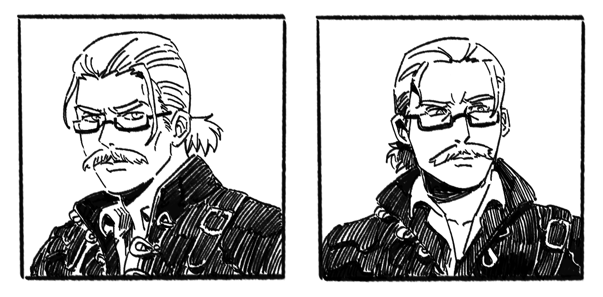

# 铎利克·欧恩斯坦

**铎利克·欧恩斯坦（Doric Ornstein）**，安德烈的学生，被视为第二席继任者但拒绝。

游历各地学习武技（蛮族牙取式、精灵魔力强化视觉等），偏好徒手，弃剑多年。

和安德烈一样都是武痴，最终有可能达到接近安德烈的高度。离别之战时比洛德强得多，离开帝都时数值版差不多 25+。在量级参照表上为 5++：超越温德林的水准，量级非常接近成熟飞龙；人形互殴比温德林更强，因为时代有差别。

离开帝都前往莫洛恩担任冒险者公会会长。照顾伊修娜（弗兰克的托付）和艾尔里奇。听到帝国内部出事风声后对二人进行试炼施压。

在帝都时偶尔会和弗兰克一起去哈雷克酒馆。
